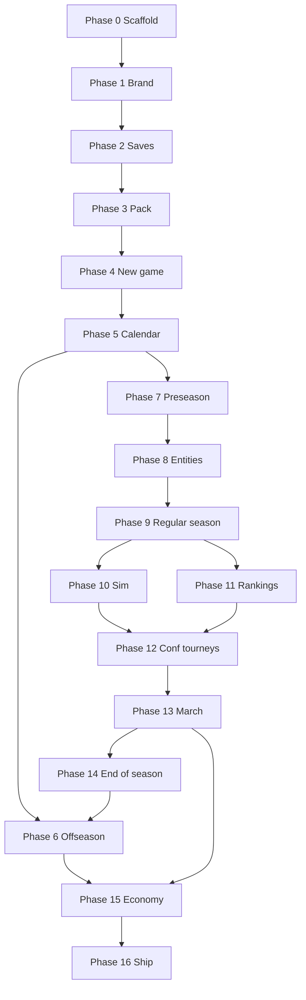

# Build checklist — implementation order

**Product:** Dynasty: College Basketball · **Studio:** Novux Games  
**Planning:** [`planning/`](../planning/) is authoritative for behavior; this doc is **execution order**.  
**Code:** [`docs/ARCHITECTURE.md`](ARCHITECTURE.md) · Android project: [`android/`](../android/)

Use phases **in order**. Do not skip persistence or calendar kernel before dynasty UI. Mark items `[x]` in your tracker as you ship.

---

## How to read each step

| Field | Meaning |
|-------|---------|
| **Build** | What to implement |
| **Done when** | Acceptance / test |
| **Spec** | Planning link(s) |
| **Code** | Target module/package |

---

## Phase 0 — Repository & CI (baseline)

| Step | Build | Done when | Spec | Code |
|------|--------|-----------|------|------|
| 0.1 | `[x]` Gradle multi-module `:app` + `:core` | `:core:test` green | [ARCHITECTURE](../docs/ARCHITECTURE.md) | `android/` |
| 0.2 | `[x]` Studio → Splash → Home Compose nav | Manual cold start flow | [app-shell](../planning/app-shell.md) | `ui.shell`, `DynastyApp` |
| 0.3 | `[ ]` CI workflow (`:core:test` on every PR) | GitHub Action passes | — | `.github/workflows/` |
| 0.4 | `[ ]` Android assemble on tag/manual | `:app:assembleDebug` artifact | — | CI optional job |

---

## Phase 1 — Brand, assets, app polish

| Step | Build | Done when | Spec | Code |
|------|--------|-----------|------|------|
| 1.1 | `[x]` Wire `Public-Assets/app-logo.svg` on splash | Logo renders sharp on `#181a25` | [branding](../planning/branding.md) | `SplashScreen`, `drawable-nodpi/app_logo.png` |
| 1.2 | `[x]` Novux studio lockup from `Novux_Logos/` | Studio screen ≠ game splash | [app-shell](../planning/app-shell.md) | `StudioScreen`, `novux_studio_lockup.png` |
| 1.3 | `[ ]` Settings: skip studio intro, audio stubs | Flags persist | [game-start](../planning/game-start.md) | `data/settings` |
| 1.4 | `[ ]` Credits + unofficial disclaimer screen | Legal copy from branding | [branding](../planning/branding.md) | `ui.shell` |
| 1.5 | `[ ]` Adaptive icon matches `Public-Assets/adaptive-icon/` | Launcher icon on device | [branding](../planning/branding.md) | `res/mipmap` |

---

## Phase 2 — Persistence & save model

| Step | Build | Done when | Spec | Code |
|------|--------|-----------|------|------|
| 2.1 | `[ ]` **Choose & document** save backend (SQLite vs JSON files) | ADR in `docs/` | [game-design](../planning/game-design.md#identity-packs--save-model) | — |
| 2.2 | `[ ]` Save slots API (list, load, delete, last played) | Home **Continue** / **Load** real | [game-start](../planning/game-start.md) | `:core` + `data/save` |
| 2.3 | `[ ]` Dynasty metadata schema (`seasonIndex`, `phase`, `packId`) | Round-trip one empty dynasty | [game-design](../planning/game-design.md) | `:core` models |
| 2.4 | `[ ]` **Week advance** checkpoint semantics | Replay before advance; lock after | [game-design](../planning/game-design.md) | `domain/calendar` |
| 2.5 | `[ ]` Corrupt-save handling on Load | Error UI per game-start | [game-start](../planning/game-start.md) | `app` |

---

## Phase 3 — Identity pack (default 365)

| Step | Build | Done when | Spec | Code |
|------|--------|-----------|------|------|
| 3.1 | `[ ]` Pack schema v1 (`teamId`, `confId`, templates) | Validator rejects bad JSON | [game-design](../planning/game-design.md#identity-packs--save-model) | `:core/pack` |
| 3.2 | `[ ]` Ship **default pack** asset from league branding | 365 teams, 32 conferences | [league-branding](../planning/league-branding.md) | `assets/pack/` |
| 3.3 | `[ ]` Display overlay (names, colors) without corrupting history | Swap pack; IDs stable | [game-design](../planning/game-design.md) | `PackRepository` |
| 3.4 | `[ ]` Import URL/TXT path (deferred UI OK after 3.2) | Attestation + parse | [game-start](../planning/game-start.md), [game-design](../planning/game-design.md) | Preseason/new-game later |

---

## Phase 4 — New dynasty wizard

| Step | Build | Done when | Spec | Code |
|------|--------|-----------|------|------|
| 4.1 | `[ ]` Nav: Home → multi-step **New** | Back stack works | [game-start](../planning/game-start.md) | `ui.newgame` |
| 4.2 | `[ ]` Coach info + avatar presets | Saved on coach entity | [game-start](../planning/game-start.md), [coach-card](../planning/coach-card.md) | `:core` + UI |
| 4.3 | `[ ]` Archetype + default O/D schemes | Matches strategy presets | [game-start](../planning/game-start.md), [strategy-schemes](../planning/strategy-schemes.md) | `:core` |
| 4.4 | `[ ]` Dynasty toggles (auto-upgrade, unlimited age) | On save metadata | [game-start](../planning/game-start.md) | — |
| 4.5 | `[ ]` School picker (prestige ≤40, unlock all) | Summary sheet + contract preview | [game-start](../planning/game-start.md) | UI + pack |
| 4.6 | `[ ]` Sign contract → bootstrap **Offseason Week 1** | Season 1, no carousel | [offseason](../planning/offseason.md), [game-start](../planning/game-start.md) | `domain/bootstrap` |
| 4.7 | `[ ]` Generate Season 1 roster (starters, class years) | 15-man cap path started | [game-design](../planning/game-design.md) | `:core` |

---

## Phase 5 — Calendar kernel

| Step | Build | Done when | Spec | Code |
|------|--------|-----------|------|------|
| 5.1 | `[ ]` `CalendarPhase` state machine | All phases in [time-system](../planning/time-system.md) | [time-system](../planning/time-system.md) | `:core/calendar` |
| 5.2 | `[ ]` Exhibition weeks 1–3 labels | Advancing empty exhib week OK | [time-system](../planning/time-system.md) | — |
| 5.3 | `[ ]` RS weeks 1–32 + bye weeks (events, conf, postseason) | Unit tests for bye logic | [time-system](../planning/time-system.md) | `:core` tests |
| 5.4 | `[ ]` Conf-tourney week count = **pack max rounds** | Short conf byes while others play | [time-system](../planning/time-system.md) | — |
| 5.5 | `[ ]` Postseason **7** league weeks always | Non-participant can advance + view brackets | [time-system](../planning/time-system.md), [postseason](../planning/postseason.md) | — |
| 5.6 | `[ ]` **End of Season** week → offseason entry | [season-review](../planning/season-review.md) gate | [season-review](../planning/season-review.md) | `ui.seasonreview` |

---

## Phase 6 — Offseason (weeks & carousel)

| Step | Build | Done when | Spec | Code |
|------|--------|-----------|------|------|
| 6.1 | `[ ]` Offseason shell + week header (Week 1–9) | Advance week persists | [offseason](../planning/offseason.md) | `ui.offseason` |
| 6.2 | `[ ]` **Coaching Carousel** (Season 2+ only) | AI background + user approvals | [offseason](../planning/offseason.md) | `:core/carousel` |
| 6.3 | `[ ]` Week 1: players leaving, ≥1 transfer intent, retention | Convince/stay flows | [offseason](../planning/offseason.md) | — |
| 6.4 | `[ ]` Week 1: pro days → draft stock | Feeds week 2 results | [offseason](../planning/offseason.md) | — |
| 6.5 | `[ ]` Weeks 2–5: recruiting + portal UI | 4-week spend window | [recruiting-engine](../planning/recruiting-engine.md), [offseason](../planning/offseason.md) | `ui.recruiting` |
| 6.6 | `[ ]` Week 2: NBA draft results | Scholarships open | [offseason](../planning/offseason.md) | — |
| 6.7 | `[ ]` Week 6 summer workouts (auto) | Report screen | [offseason](../planning/offseason.md) | — |
| 6.8 | `[ ]` Week 7 cuts + roster lock ≤15 + walk-ons | [recruiting-engine](../planning/recruiting-engine.md) | — |
| 6.9 | `[ ]` Week 8 fundraising & facility upgrades | Cash/NIL hooks | [game-design](../planning/game-design.md) | — |
| 6.10 | `[ ]` Week 9 conference offers (skip Season 1) | Realignment cards | [game-design](../planning/game-design.md) | — |

---

## Phase 7 — Preseason (single week)

| Step | Build | Done when | Spec | Code |
|------|--------|-----------|------|------|
| 7.1 | `[ ]` Preseason task checklist UI (8 tasks) | All required before Start Season | [preseason](../planning/preseason.md) | `ui.preseason` |
| 7.2 | `[ ]` Incoming class seed + Top 60 News | HS/JUCO pools | [recruiting-engine](../planning/recruiting-engine.md), [preseason](../planning/preseason.md) | `:core` |
| 7.3 | `[ ]` Tournament invites **before** schedule | 28-cap when 4-game event | [preseason](../planning/preseason.md), [ncba-branding](../planning/ncba-branding.md) | — |
| 7.4 | `[ ]` Exhibitions 0–3 + RS schedule solver | Conf visible, double-headers allowed | [preseason](../planning/preseason.md), [game-design](../planning/game-design.md) | `:core/schedule` |
| 7.5 | `[ ]` Preseason report article component | Reuse for pre/post game later | [preseason](../planning/preseason.md) | `ui.reports` |
| 7.6 | `[ ]` Start season → first exhib or RS game | [game-frame](../planning/game-frame.md) entry | [preseason](../planning/preseason.md) | Navigation |

---

## Phase 8 — Entities: players, coaches, schools

| Step | Build | Done when | Spec | Code |
|------|--------|-----------|------|------|
| 8.1 | `[ ]` Player model (ratings, position, eligibility) | Matches player card fields | [player-cards](../planning/player-cards.md), [positions](../planning/positions-and-lineup.md) | `:core` |
| 8.2 | `[ ]` Archetypes + hidden ratings / letter grades | Scout view | [player-archetypes](../planning/player-archetypes.md), [recruiting-engine](../planning/recruiting-engine.md) | — |
| 8.3 | `[ ]` Head coach + assistants (cards) | Staff tab vs support list | [coach-card](../planning/coach-card.md) | `ui.coach` |
| 8.4 | `[ ]` School hub data (prestige, SOS, NET on card) | Read-only opponent schools | [game-frame](../planning/game-frame.md) | `ui.school` |
| 8.5 | `[ ]` Job security + AD trust | Coach card + Staff tab | [coach-card](../planning/coach-card.md) | — |

---

## Phase 9 — Regular season loop

| Step | Build | Done when | Spec | Code |
|------|--------|-----------|------|------|
| 9.1 | `[ ]` In-season shell: bottom nav 4 tabs | Dashboard default | [game-frame](../planning/game-frame.md) | `ui.dynasty` |
| 9.2 | `[ ]` Calendar tab (week labels, bye display) | Matches time-system | [game-frame](../planning/game-frame.md), [time-system](../planning/time-system.md) | — |
| 9.3 | `[ ]` Schedule generation for AI leagues | 365 teams progress | [game-design](../planning/game-design.md) | `:core/league` |
| 9.4 | `[ ]` Batch sim non-user games on week advance | Standings update | [game-design](../planning/game-design.md) | — |
| 9.5 | `[ ]` Early event brackets (Island/Desert 4wk, etc.) | Elimination byes | [ncba-branding](../planning/ncba-branding.md), [time-system](../planning/time-system.md) | — |

---

## Phase 10 — Possession simulation engine

| Step | Build | Done when | Spec | Code |
|------|--------|-----------|------|------|
| 10.1 | `[ ]` Possession loop, 40:00 clock, 3–30s trips | Box score totals sane | [simulation-engine](../planning/simulation-engine.md) | `:core/sim` |
| 10.2 | `[ ]` Lineups PG–C, rotation minutes | [positions](../planning/positions-and-lineup.md) | — |
| 10.3 | `[ ]` O/D scheme modifiers | 7×7 presets | [strategy-schemes](../planning/strategy-schemes.md) | — |
| 10.4 | `[ ]` Gameplan knobs (usage, deny-primary, late fouls) | Pre-game + halftime | [strategy-schemes](../planning/strategy-schemes.md) | `ui.strategy` |
| 10.5 | `[ ]` Live text / 2s watch mode | Halftime edit | [strategy-schemes](../planning/strategy-schemes.md), [game-frame](../planning/game-frame.md) | — |
| 10.6 | `[ ]` Game preview (win %, predicted score, H2H) | 0 games played OK | [game-frame](../planning/game-frame.md) | — |
| 10.7 | `[ ]` Pregame + postgame report articles | Shared template | [preseason](../planning/preseason.md) | `ui.reports` |

---

## Phase 11 — Rankings & selection math

| Step | Build | Done when | Spec | Code |
|------|--------|-----------|------|------|
| 11.1 | `[ ]` `sosRating`, NEM, quads from results | School hub SOS 0–99 | [selection-engine](../planning/selection-engine.md) | `:core/resume` |
| 11.2 | `[ ]` Weekly **NCBA NET** (365 teams) | Drives Selection Sunday | [selection-engine](../planning/selection-engine.md) | — |
| 11.3 | `[ ]` Media & Coaches polls (human bias) | T25 callouts | [selection-engine](../planning/selection-engine.md), [game-frame](../planning/game-frame.md) | — |
| 11.4 | `[ ]` Rankings hub tabs | NET / Media / Coaches / conf | [game-frame](../planning/game-frame.md) | — |
| 11.5 | `[ ]` Selection Sunday + seed index | NCBA 76, NCI, HC | [postseason](../planning/postseason.md), [selection-engine](../planning/selection-engine.md) | `:core/selection` |

---

## Phase 12 — Conference tournaments

| Step | Build | Done when | Spec | Code |
|------|--------|-----------|------|------|
| 12.1 | `[ ]` Per-conf `TournamentTemplate` sim | Real 2026–27 formats | [game-design](../planning/game-design.md), [postseason](../planning/postseason.md) | `:core` |
| 12.2 | `[ ]` Reclass pass-over runner-up | Auto-bid rules | [postseason](../planning/postseason.md) | — |
| 12.3 | `[ ]` Conf-tourney UI + unified week calendar | Byes for short brackets | [time-system](../planning/time-system.md) | — |

---

## Phase 13 — National postseason

| Step | Build | Done when | Spec | Code |
|------|--------|-----------|------|------|
| 13.1 | `[ ]` NCBA Opening Round (24→12) | Pairing 1v24… | [postseason](../planning/postseason.md) | `:core/brackets` |
| 13.2 | `[ ]` NCBA rounds R1→NC, 4 regions | S-curve, NCBA # seeds | [postseason](../planning/postseason.md), [ncba-branding](../planning/ncba-branding.md) | — |
| 13.3 | `[ ]` NCI (32) + Heritage (16) parallel | Same 7-week calendar | [postseason](../planning/postseason.md) | — |
| 13.4 | `[ ]` **March Mayhem** hub | NCBA / NCI / HC tabs | [postseason-frame](../planning/postseason-frame.md) | `ui.march` |
| 13.5 | `[ ]` Sim user postseason games + batch rest | Week advance | [postseason](../planning/postseason.md) | — |

---

## Phase 14 — End of Season & loop closure

| Step | Build | Done when | Spec | Code |
|------|--------|-----------|------|------|
| 14.1 | `[ ]` Season review UI | Grades, prestige, final ranks | [season-review](../planning/season-review.md) | `ui.seasonreview` |
| 14.2 | `[ ]` Awards & news wrap | POTY, coach honors | [game-design](../planning/game-design.md) | — |
| 14.3 | `[ ]` History hub + GOAT list | [game-frame](../planning/game-frame.md) | `ui.history` |
| 14.4 | `[ ]` Advance year → offseason carousel | Season 2+ path | [offseason](../planning/offseason.md) | — |

---

## Phase 15 — Economy & program depth

| Step | Build | Done when | Spec | Code |
|------|--------|-----------|------|------|
| 15.1 | `[ ]` NIL collective + player deals | Retention, recruits | [game-design](../planning/game-design.md), [recruiting-engine](../planning/recruiting-engine.md) | — |
| 15.2 | `[ ]` Facility grades + upgrades | Week 8 integration | [game-design](../planning/game-design.md) | — |
| 15.3 | `[ ]` Academics → recruiting budget multiplier | Grades on school | [game-design](../planning/game-design.md) | — |
| 15.4 | `[ ]` Coach skill tree + Sunday points | Auto-spend option | [game-design](../planning/game-design.md), [coach-card](../planning/coach-card.md) | — |
| 15.5 | `[ ]` Unemployed coach mode | Job center | [game-design](../planning/game-design.md) | — |

---

## Phase 16 — Ship polish

| Step | Build | Done when | Spec | Code |
|------|--------|-----------|------|------|
| 16.1 | `[ ]` Notifications (game day, Sunday points, portal) | Android channels | [game-design](../planning/game-design.md) | — |
| 16.2 | `[ ]` Automation toggles (sim week, staff) | Settings + dynasty | [game-design](../planning/game-design.md) | — |
| 16.3 | `[ ]` Identity import hardening (URL allowlist, size cap) | [game-design](../planning/game-design.md) | — |
| 16.4 | `[ ]` Performance: 365-team week batch under target | Profiling doc | [game-design](../planning/game-design.md) | — |
| 16.5 | `[ ]` Play Store assets, privacy, offline copy | Store listing | [branding](../planning/branding.md) | — |

---

## Dependency graph (summary)

**Parallel tracks (after Phase 8):**  
- **UI track:** Phases 6–7 shells can be built with stub data while **Phase 10** sim is WIP.  
- **Sim track:** Phase 10 can start with two-team smoke tests before Phase 9 league batch.  
- **Do not** ship Selection Sunday (11.5) without NET + conf champions (11–12).

---

## Suggested “first vertical slice” (playable loop)

Minimum **one playable season** for internal testing:

1. Complete **Phases 2–5** (save + pack + new game + calendar).  
2. **Phase 7** preseason (skip polish tasks).  
3. **Phase 8–9** + **10.1–10.5** (simplified sim).  
4. **Phase 11.2** NET only (skip human polls).  
5. **Phase 12–13** bracket **stub** (single-user conf + 64 NCBA).  
6. **Phase 14.1** season review → **Phase 6.1** offseason week 1 stub.

Expand recruiting (6.5), full 365 sim (9.3), and March Mayhem UI (13.4) after slice is fun.

---

## Document maintenance

When planning docs change, update the **Spec** column links and acceptance criteria in the matching phase. Bump [Document history](#document-history) below.

### Document history

| Date | Change |
|------|--------|
| 2025-11-09 | Initial comprehensive build order (post Android scaffold merge) |
